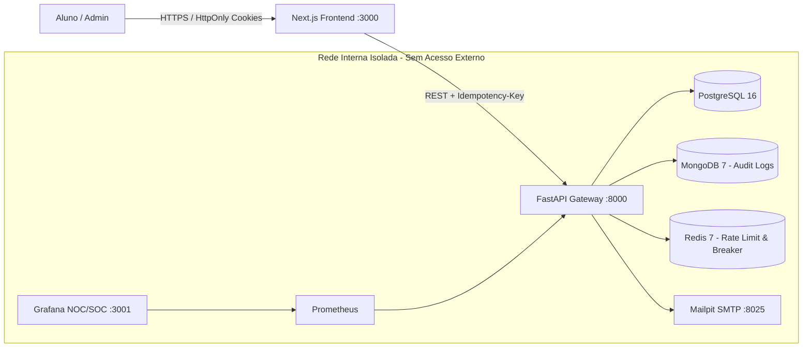

# Portal Educacional & Assistente IA Seguro — Arquitetura Full-Stack (Cód. 7758)

Solução corporativa desenvolvida sob princípios de **Zero-Trust Architecture**, **Privacy by Design (LGPD)**, **FinOps em IA Generativa** e **Observabilidade NOC/SOC**.

## 1. Arquitetura Zero-Trust & Isolamento de Rede



## 2. Como Executar (1 Comando)

```bash
cp .env.example .env
docker compose up --build -d
```

* **Aplicação Web (Aluno & Admin):** `http://localhost:3000` (Credencial Admin padrão: `admin@fiec.org.br` / `Admin@Fiec2026!`)
* **Documentação OpenAPI (Swagger):** `http://localhost:8000/docs`
* **Painel NOC/SOC (Grafana):** `http://localhost:3001`
* **Caixa de E-mails Local (Mailpit):** `http://localhost:8025`

## 3. Matriz de Controles de Segurança (ISO/IEC 27001 & NIST CSF)

| Risco / Requisito | Controle Técnico Implementado | Referência Normativa |
| --- | --- | --- |
| **Acesso Direto aos Bancos** | Segregação em `private_net` (`internal: true`) sem portas expostas no host | ISO 27001 A.8.20 / NIST PR.AC-5 |
| **SQL Injection** | ORM parametrizado + validação estrita de schema via Pydantic | OWASP A03 / ISO 27001 A.8.28 |
| **XSS & Roubo de Sessão** | Escaping nativo React + CSP Headers + JWT em Cookies `HttpOnly` e `SameSite=Strict` | OWASP A03 & A07 / NIST PR.DS-2 |
| **Vazamento de Dados (LGPD)** | Mascaramento automático (`sanitize_pii_lgpd`) antes do envio à LLM e nos logs | Lei 13.709/2018 (Art. 46) |
| **Abuso de Custos IA (FinOps)** | Token Bucket por usuário no Redis (`tiktoken`) + bloqueio HTTP 429 | OWASP LLM04 (Denial of Wallet) |
| **Resiliência & Falhas** | Circuit Breaker (`pybreaker`) + Header `Idempotency-Key` em mutações | NIST PR.PT-5 / Arquitetura Distribuída |

## 4. Testes Automatizados & DevSecOps

```bash
pytest backend/app/tests -v
bandit -r backend/app -ll
```

